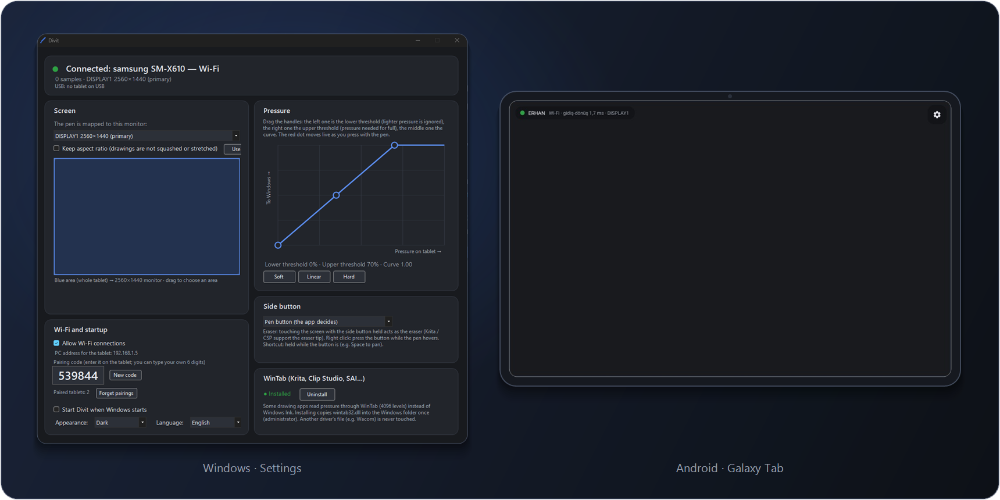

<div align="center">

<a href="https://divit.yagizerhan.dev">
  
</a>

# Divit

**Turn your Samsung Galaxy Tab and S Pen into a pressure-sensitive graphics tablet for Windows.**

Windows sees a real pen — pressure, tilt, hover and the side button over USB or Wi-Fi. Free and open source.

<p>
  <a href="https://divit.yagizerhan.dev"></a>
  <a href="https://github.com/yagizerhan/divit/releases/latest"></a>
  <a href="LICENSE"></a>
  
  
  
  
</p>

<p>
  <a href="#features">Features</a> ·
  <a href="#requirements">Requirements</a> ·
  <a href="#getting-started">Getting started</a> ·
  <a href="#building-from-source">Building</a> ·
  <a href="#documentation">Docs</a> ·
  <a href="#license">License</a>
</p>

<br />



</div>

---

## Features

- **Real pen in Windows** (Windows Ink) — pressure (1024 levels), tilt, hover, side button. No driver, no administrator rights.
- **WinTab support** — apps that use WinTab by default (Krita, Clip Studio Paint, SAI…) get pressure with their default settings, 4096 levels. Optional, one administrator prompt.
- **Low latency** — measured tablet-to-Windows latency p95 3.5 ms over USB, 7.3 ms over Wi-Fi. No buffering, no smoothing.
- **Tablet-driver settings** — target monitor, active area, aspect ratio, pressure-curve editor, side button (pen button / right click / eraser / keyboard shortcut / off).
- **USB or Wi-Fi** — USB through `adb`, Wi-Fi with a pairing code entered once per tablet; automatic reconnect; the pen is never left pressed if the connection drops.
- **Secure by default** — every connection is authenticated; keys never go on the wire.
- **English and Turkish.**

## Requirements

| | |
|---|---|
| Tablet | Samsung Galaxy Tab with S Pen (reference device: Galaxy Tab S9 FE+), Android 11+ (tested on Android 13 and later) |
| PC | Windows 11 |
| USB mode | A USB data cable and USB debugging on the tablet. The installer downloads `adb` ([Android Platform-Tools](https://developer.android.com/tools/releases/platform-tools)) from Google for you, unless the Android SDK is already installed |
| Wi-Fi mode | PC and tablet on the same local network |

## Getting started

1. **PC:** install Divit (`DivitSetup-<version>.exe` from Releases) and start it. The settings window opens; the tray icon shows the connection status.
2. **Tablet:** install the Divit APK and open it. Choose **USB cable** or **Wi-Fi**.
3. **USB, once on the tablet:**
   1. *Settings → About tablet → Software information* → tap **Build number** 7 times (Developer options are turned on).
   2. *Settings → Developer options* → turn on **USB debugging**.
   3. Connect the tablet to the PC with a USB data cable and accept **"Allow USB debugging?"** (tick *Always allow from this computer*).

   From then on just plug in the cable; the PC sets up the connection by itself.
4. **Wi-Fi:** pick the PC on the tablet (Wi-Fi is on by default on the PC) and enter the 6-digit code shown on the PC (only the first time).
5. Draw. In Krita, either install WinTab support (installer checkbox / settings window) or choose *Settings → Configure Krita → Tablet settings → Windows 8+ Pointer Input*.

## Building from source

**Windows host** (needs the .NET 10 SDK; the WinTab DLL needs Visual Studio with "Desktop development with C++"):

```bash
host-windows/native/wintab32/build.cmd
```

```bash
dotnet test host-windows/Divit.sln
```

```bash
dotnet build host-windows/src/Divit.Host -c Release
```

**Tablet app** (needs JDK 17+ and the Android SDK; Gradle 8.10):

```bash
cd tablet-android && ./gradlew testDebugUnitTest assembleDebug
```

**Installer** (needs Inno Setup 6): see [installer/README.md](installer/README.md).

**Protocol test vectors** (Python 3 with `cryptography`): `python -I protocol/test-vectors/generate.py`.

## Documentation

| Document | Contents |
|---|---|
| [docs/requirements.md](docs/requirements.md) | Target environment, scope, requirements, latency targets |
| [docs/architecture.md](docs/architecture.md) | Components, hot-path rules, pen state machine, mapping, security model |
| [protocol/SPEC.md](protocol/SPEC.md) | Wire protocol, authentication, discovery |
| [docs/wintab.md](docs/wintab.md) | WinTab compatibility layer |
| [docs/research.md](docs/research.md) | Validation experiments and measurements |
| [docs/decisions.md](docs/decisions.md) | Decision record |
| [docs/releasing.md](docs/releasing.md) | Building signed release artifacts |
| [docs/privacy.md](docs/privacy.md) | Privacy policy |

## Contributing

See [CONTRIBUTING.md](CONTRIBUTING.md). Contributions are accepted under the DCO (`Signed-off-by`).

## License

The source code is licensed under **GPL-3.0-only** ([LICENSE](LICENSE)): you may use, study, change and share it, and derivatives must stay open under the same license. The name and logo are covered separately by [TRADEMARKS.md](TRADEMARKS.md): modified versions must be published under a different name.

*"Samsung", "Galaxy" and "S Pen" are trademarks of Samsung Electronics. Divit is an independent project and is not affiliated with or endorsed by Samsung.*
