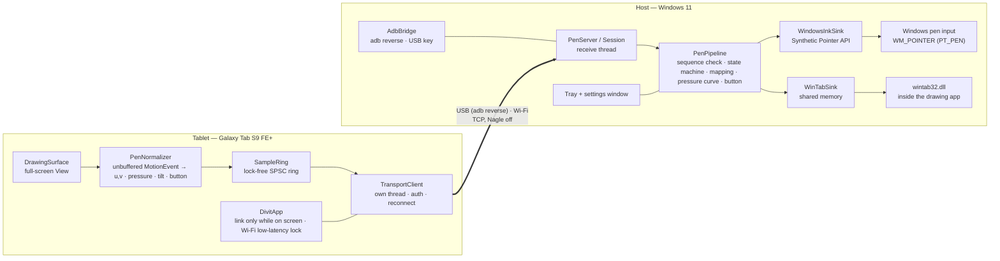
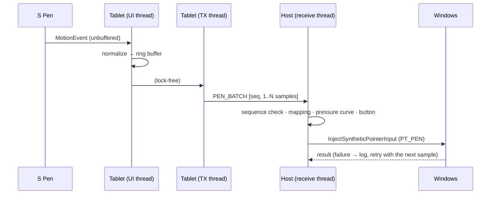
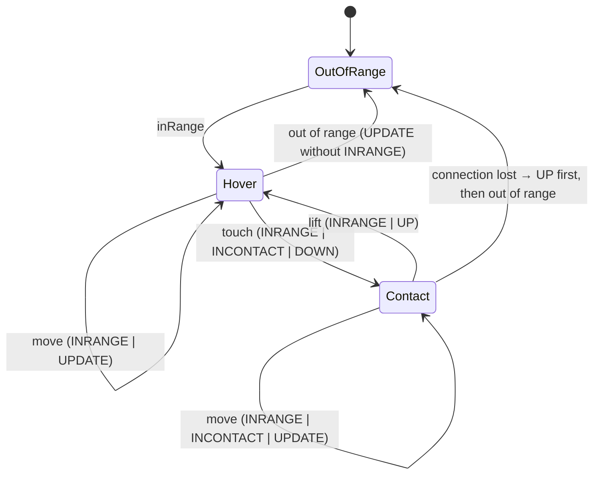

# Architecture

> Reasons behind the choices: [decisions.md](decisions.md). Wire format: [protocol/SPEC.md](../protocol/SPEC.md).

## 1. Overview

Two native apps with a versioned, platform-independent protocol between them:

- **Tablet app** (Galaxy Tab S9 FE+, Kotlin): captures S Pen events and sends them without delay. The tablet acts as a **drawing surface**.
- **Host app** (Windows 11, C#/.NET): injects the events into Windows as a **pen**, and offers tablet-driver-style settings.



**Principles:**
1. The **hot path** (pen event → Windows injection) is short and queue-free: no buffering, no smoothing, no UI thread.
2. Everything OS-specific sits behind an interface (`IPenSink`). Protocol, mapping and pressure curve live in the shared core.
3. Optional features must add no dependency to the pen path.

## 2. Tablet app (Android, Kotlin)

| Component | Responsibility |
|---|---|
| `ui/DrawingSurface` | Full-screen, immersive `View`, `FLAG_KEEP_SCREEN_ON`. Edge gestures are excluded. Shows the active area. Requests `requestUnbufferedDispatch` when attached and at the start of every gesture. Only `TOOL_TYPE_STYLUS` is accepted; fingers are ignored. |
| `capture/PenNormalizer` | Converts coordinates to 0–1 relative to the surface, keeps raw pressure, derives the side button (`BUTTON_STYLUS_PRIMARY`), hover/contact flags and tiltX/tiltY. Historical samples are always read. |
| `capture/SampleRing` | Single-producer / single-consumer lock-free ring: the main thread writes, the TX thread reads. |
| `net/TransportClient` | Blocking socket writes on **its own thread**, handshake and authentication, ping/pong, automatic reconnect. Each `start()` gets its own run object so a stop/start pair can never leave two threads running. Reports a `Reason` the UI turns into localized text. |
| `net/UsbKeyReceiver` | Receives the PC's USB key over adb (guarded by `android.permission.DUMP`). |
| `net/Discovery` | Finds Divit PCs on the LAN (UDP broadcast). |
| `DivitApp` | Owns the connection. It runs only while a Divit screen is visible (pen input can only be captured in the foreground): 5 s after the last screen leaves, the link closes and the PC releases the pen. Holds the Wi-Fi `WIFI_MODE_FULL_LOW_LATENCY` lock while connected over Wi-Fi. No background service. |
| `ui/SettingsActivity` | Connection type, PC address/discovery, pairing, brightness, app language. |

### 2.1. Samsung-specific notes

- **Air Command:** pressing the side button while hovering opens Samsung's Air Command panel. The drawing screen carries the activity meta-data Samsung Notes uses (`SEM_DISABLE_AIRCOMMAND = button_noaction|detach_floating`, `BLOCK_DOUBLE_TAP_ACTION = true`). It only applies while Divit is in front; the system setting is unchanged. Verified: the panel no longer opens.
- **Side button:** not delivered as `ACTION_BUTTON_PRESS`; `buttonState` carries `BUTTON_STYLUS_PRIMARY`, both hovering and in contact.
- **No eraser tip** on the S9 FE+ pen. Erasing is done by assigning the side button (IN-07).
- **Pressure and tilt:** ~4096 levels (0…1). In testing the hardest press peaked around 0.68, so the default upper threshold of the pressure curve is 0.70. Tilt comes from `AXIS_TILT` (0…π/2) + `AXIS_ORIENTATION`.
- **Sampling:** ~366 Hz, regular. With per-gesture unbuffered dispatch, contact samples arrive one per event (p95 2.9 ms). Hover is batched at 90 Hz unless the request is renewed on every hover event (which Divit does).

## 3. Host app (Windows 11, C#/.NET)

| Project | Contents | On the hot path? |
|---|---|---|
| `Divit.Protocol` | Message types, allocation-free binary read/write (`Span<byte>`), authentication helpers | Yes |
| `Divit.Core` | `PenPipeline` (sequence check, state machine, mapping, pressure curve, button), `PenDeviceSink`/`PenTransitions`, clock sync, latency histogram, `PenServer`, pairing store, host identity | Yes |
| `Divit.Platform.Windows` | `WindowsInkSink` (P/Invoke), `WinTabSink`, `InputSender`, monitor list | Yes |
| `native/wintab32` | C WinTab provider DLL loaded into drawing apps | Yes |
| `Divit.Host` | Tray, settings window, adb bridge, WinTab installer, localization | No |

### 3.1. Hot-path rules

- The receive thread does **parse → map → inject** in one place. No queue, no thread hop.
- No allocation per sample (structs + `Span`). `GCSettings.LatencyMode = SustainedLowLatency`.
- The receive thread runs at raised priority.
- Logging and statistics on the hot path only increment counters; writing happens in the background.
- Settings changes (curve, area) are applied by atomically swapping an immutable object. No locks on the hot path.

### 3.2. Platform interfaces

```csharp
public interface IPenSink : IDisposable
{
    bool Apply(in PenOutput output);   // false on failure; the pipeline retries with the next sample
}

public abstract class PenDeviceSink : IPenSink   // for stateful devices (the Windows synthetic pen)
{
    protected abstract bool Inject(in PenOutput o, PenTransition t);
}
```

`WindowsInkSink` (a `PenDeviceSink`) and `WinTabSink` run side by side through `CompositeSink`; the state machine follows Windows Ink. The transport is TCP only today; there is no transport abstraction yet.

## 4. Pen data flow



### 4.1. Pen state machine (host)



The pipeline state is the last transition the sink **accepted**; a failed injection is retried with the next sample. Separately, `PenDeviceSink` tracks the state Windows actually accepted and turns every request into valid steps (e.g. inserting `UP` before a requested `Hover` while Windows still sees contact). So a failure or a session change can never leave the pen pressed. Flags used: `PRIMARY | CONFIDENCE`, plus `FIRSTBUTTON` in contact.

### 4.2. Area mapping (tablet driver logic)

- The tablet sends `u, v ∈ [0,1]` relative to the drawing surface.
- The host applies the **active tablet area** (IN-09), then maps to the target monitor rectangle `R`: `x = R.left + u'·R.width`, `y = R.top + v'·R.height`.
- With **keep aspect ratio** on, the tablet area is cropped to the monitor's ratio. The S9 FE+ screen is 16:10 and a typical monitor 16:9, so a thin dead band remains at the top and bottom.
- The host runs **Per-Monitor DPI Aware v2**.
- **Injection coordinates:** `ptPixelLocation` is relative to the **top-left corner of the virtual desktop**: `(x − VirtualScreen.Left, y − VirtualScreen.Top)`. Only `WindowsInkSink` applies this; the core works in screen coordinates. The offset is re-read when the display layout changes.

### 4.3. Pressure and button

- The pressure curve is applied on the host: `p' = clamp((p − pMin)/(pMax − pMin))^γ` → `round(p'·1024)` for Windows Ink (at least 1 in contact), full float resolution for WinTab. Presets: soft, linear, hard.
- Side button: *pen button* (Windows barrel, default) · *right click* (while hovering) · *eraser* (Windows eraser flag; latched at the start of contact) · *keyboard shortcut* (sent with `SendInput`; the keys go down with the button and up when it is released, the pen leaves range or the connection ends; a lone Alt, Ctrl or Shift can be assigned) · *off*.

## 5. Transport

- **One TCP connection, `TCP_NODELAY`.** Pen data is tiny: ~32 B × a few hundred Hz ≈ 12 KB/s.
- **USB (primary):** `adb reverse tcp:47470 tcp:47470`, kept in place by the host (`adb track-devices` + a 5 s fallback check). In USB-only mode the host listens on `127.0.0.1` only. USB debugging must be turned on once on the tablet.
- **Wi-Fi (secondary):** the same code path, pairing required, Wi-Fi low-latency lock.
- **Heartbeat:** a ping every 250 ms; 1 s without any frame = dead → `ReleaseAll()` + reconnect.
- **Authentication:** HMAC challenge-response on every connection (USB key or pairing key); pairing uses ECDH. Details: [SPEC §3.2–3.3](../protocol/SPEC.md).

## 6. Latency measurement

- Clock sync (NTP-like): `offset = ((t1 − t0) + (t2 − t3)) / 2`, using the lowest-RTT measurement.
- On each injection the host records `inject_time − (t_us + offset)` in a histogram → p50 / p95 / p99 in the tray.

## 7. WinTab compatibility layer

See [wintab.md](wintab.md). In short: a C `wintab32.dll` placed in `System32`/`SysWOW64` (one administrator prompt) reads pen packets from shared memory written by the host and delivers them as WinTab packets to the app it is loaded into. The cursor still moves through Windows Ink.

## 8. Security model

| Threat | Mitigation |
|---|---|
| Someone on the LAN connects to the host and injects input | Wi-Fi listener off by default. Pairing code required, then HMAC challenge-response on every connection (the key never goes on the wire). Turning Wi-Fi off also blocks connections opened earlier and closes a connected Wi-Fi tablet; "Forget pairings" disconnects it too. |
| Many or stuck connections before authentication | At most 4 at once; each must be accepted within 10 s (150 s while the user types the pairing code). They run at normal thread priority; only the accepted session's receive thread gets the highest priority. |
| Another app on the tablet uses the `adb reverse` tunnel | USB is authenticated too: the USB key goes over adb only to Divit's `DUMP`-guarded receiver. No pairing over USB. |
| A fake PC (same name/address, spoofed discovery) extracts secrets from the tablet | The PC proves itself first; the tablet remembers the expected `hostId` and sends nothing if the proof or ID does not match. Discovery looks the PC up by ID. |
| Man-in-the-middle at the moment of pairing | **Not covered** (a 6-digit code is not enough). Pair on a trusted network. A passive eavesdropper cannot get the key thanks to ECDH. |
| Eavesdropping on pen data | Not encrypted (authenticated only). Use Wi-Fi on trusted networks. |
| Malformed packets | Length limits, range checks, NaN rejection; a bad frame drops the connection. |
| Fake / modified builds | Official builds with SHA-256 checksums from a single channel; name and logo policy ([TRADEMARKS.md](../TRADEMARKS.md)). |

## 9. Error handling

| Situation | Behavior |
|---|---|
| Connection lost / cable pulled | `ReleaseAll()`, "not connected" on the tablet, reconnect with exponential backoff (≤ 1 s) |
| Another tablet connects | The previous one gets `BYE(3)`, its pen is released, and it does not reconnect by itself |
| Sequence gap | Logged; missing samples are not waited for (real time) |
| Injection failure | Logged; the same transition is retried; the device state guard keeps transitions valid |
| Monitor layout / DPI change | The mapping rectangle and virtual-desktop offset are recomputed |
| Tablet rotated | The app is landscape only |

## 10. Distribution

- **Host:** Windows installer (Inno Setup) or ZIP from GitHub Releases. Pen mode needs no administrator rights; WinTab is an optional checkbox in the installer.
- **Tablet:** APK from GitHub Releases (and app stores where listed).
- **USB:** needs `adb` (Android platform-tools). The installer downloads it from Google into `platform-tools\` next to the app unless one is already installed; the host looks in the SDK, next to the app, then `PATH`.

## 11. Repository layout

```
divit/
├─ README.md · CONTRIBUTING.md · TRADEMARKS.md · LICENSE
├─ docs/            requirements, architecture, decisions, research, wintab, releasing, privacy, brand/
├─ protocol/        SPEC.md, test-vectors/ (Python reference encoder)
├─ host-windows/
│  ├─ src/          Divit.Protocol, Divit.Core, Divit.Platform.Windows, Divit.Host
│  ├─ native/wintab32/
│  └─ tests/        Divit.Tests
├─ tablet-android/  app/, tools/strings.py
└─ installer/       Inno Setup script
```
