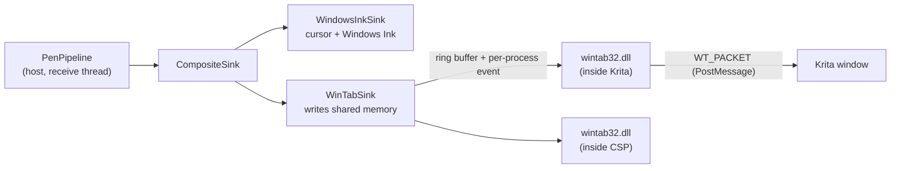

# WinTab compatibility layer

> Decision: [K-06](decisions.md). Requirement: IN-11.
>
> - Code: `host-windows/native/wintab32/` (C, MSVC; `build.cmd` builds x64 + x86), host side `WinTabSink` + `CompositeSink`, setup `WinTabInstaller` (UAC) and the installer checkbox.
> - **End-to-end tests** (`WinTabTests`): host samples pass through shared memory and the real `wintab32.dll` and are read with `WTPacketsGet`. Position, Y flip, 4096-level pressure, tip/side button, pen/eraser cursor (`TPS_INVERT`), consecutive serials, and recovery after a host crash/restart are covered.

## Why

Krita, Clip Studio Paint, Photoshop (older modes) and SAI read pressure through the **WinTab** API. A real Wacom driver offers both Windows Ink and WinTab. Without WinTab the user has to switch those apps to "Windows Ink" mode. The goal: **pressure works with the apps' default settings.**

Bonus: WinTab carries **4096 pressure levels** (Windows Ink: 1024), so the S Pen's full resolution gets through.

## Architecture

- **The cursor moves through Windows Ink**; WinTab carries only pen data (position, pressure, tilt, buttons). Mouse messages produced by Windows Ink are marked as coming from a pen, so WinTab apps (Qt/Krita) should not count them twice.
- **Plain C DLL**: loaded into the app's process, it must not carry the .NET runtime. Built for x64 and x86.
- **Read-only:** the DLL writes nothing to the host except its own consumer registration. Without a host it behaves like "no pen in range"; the app never blocks.

## Shared memory contract (v1)

Name: `Local\Divit.WinTab.v1` (per session; created by the host). All fields little-endian.

| Offset | Field | Type | Description |
|---|---|---|---|
| 0 | `magic` | u32 | `0x54575644` ("DVWT") |
| 4 | `version` | u32 | 1 |
| 8 | `hostPid` | u32 | |
| 12 | `connected` | u32 | Tablet connected (1/0) |
| 16 | `sysOrgX`, `sysOrgY`, `sysExtX`, `sysExtY` | 4 × i32 | The monitor the pen is mapped to (virtual desktop pixels) |
| 32 | `pressureLevels` | u32 | 4096 |
| 36 | `surfaceWidthUm`, `surfaceHeightUm` | 2 × u32 | The tablet's drawing surface in micrometres, from its `SURFACE_INFO`; the DLL reports the tablet resolution (`DVC_X`/`DVC_Y`) from it. 0 = unknown (default 26.6 × 16.6 cm) |
| 44 | `generation` | u32 | A new random value every time the host opens the section |
| 48–63 | reserved | | |
| 64 | `writeIndex` | u32 | Total packets written; wraps at 2³² (ring index = n & 1023) |
| 72 | `consumers[16]` | 16 × (u32 pid, u32 reserved) | DLL instances register here |
| 256 | `ring[1024]` | 1024 × 32 bytes | Packets |

**Packet (32 bytes):** `seq:u32` · `timeMs:u32` (GetTickCount) · `x:f32` · `y:f32` (0…1 within the monitor, y down) · `pressure:f32` (0…1, curve applied) · `tiltX:i16` · `tiltY:i16` (degrees) · `flags:u16` (1 in range, 2 contact, 4 side button, 8 eraser) · 6 reserved bytes.

**Synchronization:** the host writes the packet, then increments `writeIndex` (release). Each DLL instance creates an auto-reset event `Local\Divit.WinTab.v1.<pid>` and writes its pid into `consumers`. After every write the host signals the registered events. The DLL reads from its last index up to `writeIndex` (unsigned arithmetic, so the wrap at 2³² is seamless); if it fell more than 1024 behind, it skips ahead (`TPS_QUEUE_ERR`). When `generation` changes the host has restarted and its index began again at 0, so the DLL reads from 0.

When the host starts it resets the header but **keeps consumer registrations** (after a host crash the section is still the one the DLLs in open apps hold); dead processes are reaped every 2 s. The DLL also checks its registration on every wake and re-registers if it was removed.

## The WinTab the DLL provides

- **Functions:** `WTInfoA/W`, `WTOpenA/W`, `WTClose`, `WTPacketsGet`, `WTPacketsPeek`, `WTPacket`, `WTEnable`, `WTOverlap`, `WTGetA/W`, `WTSetA/W`, `WTQueueSizeGet/Set`, `WTQueuePacketsEx`, `WTDataGet`, `WTDataPeek`, `WTConfig`, `WTExtGet/Set`, `WTSave`, `WTRestore`, `WTMgr*` (empty).
- **Device:** one device "Divit (Samsung S Pen)"; X/Y 0…32767, pressure 0…4095, orientation (azimuth 0…3600, altitude 0…900).
- **Cursors:** 3 (0 mouse/puck, 1 pen, 2 eraser). Qt/Krita derive the cursor type from `cursor % 3`.
- **Packet fields:** in the specification's order according to `lcPktData` (CONTEXT, STATUS, TIME, CHANGED, SERIAL, CURSOR, BUTTONS, X, Y, Z, NORMAL_PRESSURE, TANGENT_PRESSURE, ORIENTATION, ROTATION). Relative buttons/coordinates in `lcPktMode` are supported.
- **Coordinates:** tablet space (0…32767, y up) → `lcInOrg/Ext` → `lcOutOrg/Ext` (a negative extent flips the axis). The system context (`WTI_DEFSYSCTX`) reports the monitor Divit maps to as `lcSysOrg/Ext`.
- **Messages:** `WT_PACKET`, `WT_PROXIMITY`, `WT_CSRCHANGE`, `WT_CTXOPEN/CLOSE/OVERLAP` (when `CXO_MESSAGES` is set).
- Packets go only to the foreground app, like real drivers.

## Installation

`wintab32.dll` (64-bit) → `C:\Windows\System32`, (32-bit) → `C:\Windows\SysWOW64`. Needs **administrator rights** once (the only exception to NFR-INST). The installer offers it as a checkbox; the settings window can repair or remove it (a separate helper process through UAC). Another `wintab32.dll` (Wacom etc.) is never overwritten; the user is told instead. Uninstalling Divit removes the DLL from both folders only if it is still Divit's (checked by the marker export), whether the installer or the settings window put it there; if an app still has it loaded, it is deleted on the next restart. A file another driver has put there since is left alone.
