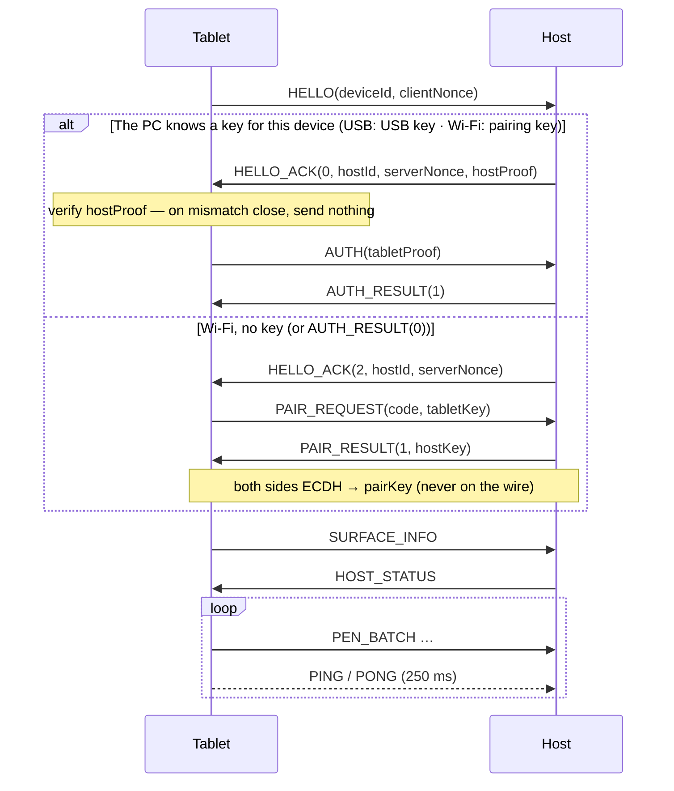

# Divit protocol — version 1

> Status: **Draft 1.0** (authentication added 6 Nov 2026, §3.1–3.3). Background: [architecture](../docs/architecture.md). Test vectors: [`test-vectors/`](test-vectors/) (generated by an independent Python reference encoder; the C# and Kotlin implementations must match it byte for byte).

Tablet (client) and host PC (server) talk over **one TCP connection** with `TCP_NODELAY`. On USB the tablet connects to `127.0.0.1:47470`, which `adb reverse` forwards to the PC; on Wi-Fi it connects to the PC's LAN address on the same port.

## 1. General rules

- All numbers are **little-endian**. `f32` is IEEE-754. `str` = `u8` length + UTF-8 bytes (at most 255 bytes). `bytes8` = `u8` length + bytes.
- Timestamps are **microseconds** on each device's own **monotonic** clock (Android `CLOCK_MONOTONIC`, i.e. `System.nanoTime()/1000`, the same base as `MotionEvent` times; Windows `Stopwatch`). The offset between the two clocks is measured with `PING`/`PONG` (§3.4).
- A receiver **ignores unknown message types** (forward compatibility). For a **known** message with a wrong length, out-of-range values or `NaN`, it drops the connection.
- A frame payload is at most **65 536 bytes**. Anything larger drops the connection.

## 2. Frame

| Field | Type | Description |
|---|---|---|
| `version` | u8 | Major version. This document: **1**. A mismatch is rejected. |
| `channel` | u8 | 0 = control, 1 = pen |
| `type` | u16 | Message type (§3) |
| `length` | u32 | Payload length (excluding the header) |
| `payload` | `length` bytes | |

The header is 8 bytes.

## 3. Messages

| Type | Name | Direction | Channel |
|---|---|---|---|
| `0x0001` | `HELLO` | T → H | 0 |
| `0x0002` | `HELLO_ACK` | H → T | 0 |
| `0x0003` | `PAIR_REQUEST` | T → H | 0 |
| `0x0004` | `PAIR_RESULT` | H → T | 0 |
| `0x0005` | `AUTH` | T → H | 0 |
| `0x0006` | `AUTH_RESULT` | H → T | 0 |
| `0x0010` | `PING` | ↔ | 0 |
| `0x0011` | `PONG` | ↔ | 0 |
| `0x0020` | `SURFACE_INFO` | T → H | 0 |
| `0x0030` | `PEN_BATCH` | T → H | 1 |
| `0x0040` | `HOST_STATUS` | H → T | 0 |
| `0x00FF` | `BYE` | ↔ | 0 |

### 3.1. `HELLO` (T → H)

The first message. The host processes nothing else before answering with `HELLO_ACK`.

| Field | Type | Description |
|---|---|---|
| `minor` | u16 | Minor version (this document: 1) |
| `transport` | u8 | 0 = USB, 1 = Wi-Fi (informational; the host decides by the connection's origin) |
| `capabilities` | u8 | bit0 pressure · bit1 tilt · bit2 side button · bit3 hover · bit4 eraser tip |
| `deviceId` | 16 bytes | Random ID created at install |
| `clientNonce` | 16 bytes | A new random number for every connection |
| `model` | str | e.g. `samsung SM-X610` |

### 3.2. `HELLO_ACK` (H → T) and authentication

| Field | Type | Description |
|---|---|---|
| `result` | u8 | 0 = prove yourself (the host knows a key for this device) · 1 = version mismatch · 2 = no key (Wi-Fi: pairing required) |
| `minor` | u16 | Host minor version |
| `hostName` | str | Computer name (shown on the tablet) |
| `hostId` | 16 bytes | The PC's permanent ID. Not secret; the tablet picks its key by it. |
| `serverNonce` | 16 bytes | A new random number for every connection |
| `hostProof` | 32 bytes | The PC's proof when `result = 0`, otherwise zero |

**Key `K`** (32 bytes): on USB the PC's **USB key** (§3.2.1), on Wi-Fi the device's **pairing key** (§3.3).

```
hostProof   = HMAC-SHA256(K, "DIVIT-HOST1" ‖ deviceId ‖ hostId ‖ clientNonce ‖ serverNonce)
tabletProof = HMAC-SHA256(K, "DIVIT-TAB1"  ‖ deviceId ‖ hostId ‖ clientNonce ‖ serverNonce)
```

Labels are ASCII, `‖` is concatenation. Both nonces are fresh for every connection, so a recorded proof cannot be replayed.

**Flow:**

1. The tablet verifies `hostProof` **first**. If it does not match (a fake PC) the tablet closes the connection without sending anything. On Wi-Fi the tablet remembers the `hostId` expected at this address; a different `hostId` also closes the connection (the address now belongs to another PC, or someone is imitating it).
2. The tablet sends `AUTH`: `proof:32 bytes` = `tabletProof`. If the tablet has no key for this PC, `proof` is zero.
3. The host replies `AUTH_RESULT`: `ok:u8` (1 = accepted). Once accepted the session is open.
   - `ok = 0` on USB: the host resends its USB key over adb (§3.2.1); the tablet reconnects shortly after.
   - `ok = 0` on Wi-Fi: the tablet deletes its old key and continues with pairing on the same connection (§3.3).
   - At most 3 failed `AUTH` per connection, then `BYE(2)`.
- With `result = 2` the tablet goes straight to pairing.
- Before acceptance the host only accepts `AUTH`, `PAIR_REQUEST`, `PING`, `PONG` and `BYE`. Pen data drops the connection.
- While Wi-Fi connections are not allowed, the host refuses `AUTH` and `PAIR_REQUEST` on Wi-Fi connections (including connections opened before Wi-Fi was turned off).

#### 3.2.1. USB key

`adb reverse` forwards the tablet's `localhost:47470` to the PC, so **every** app on the tablet could connect to that port. That is why USB connections are authenticated too.

- The PC creates a permanent **USB key** (32 bytes) and its `hostId` (`%APPDATA%\Divit\identity.json`).
- When the tablet is ready on USB, the PC sends the key over adb **only to Divit's receiver**:
  `adb shell am broadcast -a io.github.yagizerhan.divit.action.USB_KEY -n io.github.yagizerhan.divit/.net.UsbKeyReceiver -f 0x20 --es hostId <hex> --es key <hex>`
- The receiver is guarded by `android.permission.DUMP` (protection level `signature|privileged|development`). The adb shell and the system hold it; an ordinary app cannot request it. The only way an app gets it is someone running `adb shell pm grant <app> android.permission.DUMP` — that person already controls the device over adb. So in practice no other app can write the key (the key is never readable by other apps either way). Once the receiver has stored the key it returns `RESULT_OK` (-1).
- The tablet stores keys per `hostId` (several PCs are possible).
- There is no pairing (`PAIR_REQUEST`) over USB; the host refuses it.

### 3.3. `PAIR_REQUEST` (T → H) / `PAIR_RESULT` (H → T)

While Wi-Fi connections are allowed, the host shows a **6-digit** code. The code is **fixed**: the host creates it once and keeps it; it changes only when the user changes it on the PC (a random new code or their own 6 digits).

`PAIR_REQUEST`: `code:u32` (0–999 999) · `deviceName:str` · `tabletKey:bytes8`

`PAIR_RESULT`: `ok:u8` (1 = success) · `hostKey:bytes8` (empty on failure) · `reason:u8` (minor 1; on failure: 0 = wrong code, 1 = pairing paused, 2 = Wi-Fi connections not allowed; ignored on success. A minor-0 host omits it: read as 0)

`tabletKey` / `hostKey`: a **P-256** public key created anew for each pairing, as `SubjectPublicKeyInfo` (DER, 91 bytes). Both sides compute the ECDH shared secret (32 bytes, the x coordinate):

```
pairKey = HMAC-SHA256(ECDH shared secret, "DIVIT-PAIR1" ‖ deviceId ‖ hostId)
```

- If the code is right, the host stores `pairKey` with the `deviceId` and treats the connection as **accepted** (no separate `AUTH`). The tablet stores `pairKey` with the `hostId` and remembers the `hostId` for this address.
- The key never travels on the wire. An **eavesdropper** (passive attacker) who sees the code still cannot obtain the key.
- **Known limit:** there is no protection against an active man-in-the-middle **at the moment of pairing**; a 6-digit code is not enough for that. Pair on a network you trust.
- The host checks `tabletKey` before the code: a key that is not a valid P-256 `SubjectPublicKeyInfo` drops the connection and does not count as a guess.
- At most **3** wrong codes per connection, then the connection is closed. After 10 wrong attempts in total pairing pauses (even the right code is refused during the pause, `reason = 1`), then opens again with the same code. The first pause lasts **30 s**; each further pause without a successful pairing in between lasts twice as long, up to **30 min**. A successful pairing or a new code starts over.
- If the tablet holds a key for this `hostId` but the host answers `HELLO_ACK(2)` (no proof), the tablet warns the user before asking for the code: this is expected after "Forget pairings" on the PC, but it is also what a device imitating the PC would do. The old key is kept until a new pairing succeeds.
- A connection must be accepted (`AUTH_RESULT(1)` or `PAIR_RESULT(1)`) within **10 s**, or within **150 s** once the host is waiting for the pairing code; otherwise the host closes it. At most **4** connections per transport (USB and Wi-Fi counted separately) may wait for acceptance at the same time; the host closes extra ones immediately. Connections waiting on Wi-Fi therefore never block the USB tablet.
- Pen data is not encrypted (authentication, not confidentiality).

### 3.4. `PING` / `PONG`

`PING`: `id:u32` · `t0:i64` (sender's clock)

`PONG`: `id:u32` · `t0:i64` (echoed) · `t1:i64` (time received, responder's clock) · `t2:i64` (time sent, responder's clock)

- Both sides send a `PING` every **250 ms**. If no frame arrives for **1 s** the connection is considered dead: the host calls `ReleaseAll()`, the tablet reconnects.
- When the `PONG` arrives at `t3`, the PING sender computes `rtt = (t3 − t0) − (t2 − t1)` and `offset = ((t1 − t0) + (t2 − t3)) / 2` (responder's clock − sender's clock). The measurement with the lowest RTT among the last 16 is used.

### 3.5. `SURFACE_INFO` (T → H)

`widthPx:u32` · `heightPx:u32` · `widthMm:f32` · `heightMm:f32`

`widthPx`, `heightPx` > 0; `widthMm`, `heightMm` in **1…10 000** (finite). Anything else drops the connection.

Sent right after acceptance and whenever the drawing surface size changes. The host uses it to keep the aspect ratio.

### 3.6. `PEN_BATCH` (T → H, channel 1)

`count:u16` (1–64) · `reserved:u16` (0) · `count × PenSample`

The payload length must be exactly `4 + 32·count` (the `PenSample` size is fixed in version 1).

**`PenSample` (32 bytes):**

| Offset | Field | Type | Range / meaning |
|---|---|---|---|
| 0 | `t_us` | i64 | Hardware time of the sample (tablet clock, µs) |
| 8 | `u` | f32 | 0…1, left to right on the surface |
| 12 | `v` | f32 | 0…1, top to bottom on the surface |
| 16 | `pressure` | f32 | 0…1, raw (the curve is applied on the host) |
| 20 | `tiltX` | f32 | −90…90 degrees, + to the right |
| 24 | `tiltY` | f32 | −90…90 degrees, + toward the user |
| 28 | `flags` | u16 | bit0 `inRange` · bit1 `inContact` · bit2 `barrel` · bit3 `historical` · bit4 `eraser` |
| 30 | `seq` | u16 | Increments by 1 per sample, wraps to 0 |

- `u`, `v` accept a **±0.01** tolerance (surface edge); the host then clamps to `[0,1]`.
- `inContact` requires `inRange`. Without `inRange` the sample means "out of range".
- `historical`: an older sample Android put into the batch. The host processes these in order too.
- `seq` gaps are counted and logged on the host; missing samples are not waited for.

### 3.7. `HOST_STATUS` (H → T)

`monitorName:str` · `areaLeft:f32` · `areaTop:f32` · `areaRight:f32` · `areaBottom:f32`

The part of the tablet in use (0…1, after aspect-ratio cropping). Sent after acceptance and on settings changes.

### 3.8. `BYE`

`reason:u8` · 0 = normal close · 1 = protocol error · 2 = pairing failed · 3 = another tablet connected

The sender closes the connection right after. A tablet that receives `BYE(3)` does not reconnect by itself.

## 4. Connection flow



- The host accepts **one tablet** at a time. When a new tablet is accepted, the previous one gets `BYE(3)`.
- Whenever a connection closes, the host first calls `ReleaseAll()` (`UP` if in contact, then out of range). The pen never stays "pressed" (CN-03).

## 5. Latency measurement

On every injection the host records `latency = injection_time − (t_us + offset)` into a histogram. `offset` comes from the host's own `PING`s (§3.4).

## 6. Versioning

- Backward-compatible additions (a new message type, a new field at the **end** of a message) increase `minor`. A receiver ignores extra bytes at the end of a known message.
- Incompatible changes increase `version`.

## 7. Discovery (Wi-Fi, UDP 47471)

Lets the tablet find the PC without typing an address. Independent of the TCP protocol, plain UTF-8 text.

| Direction | Content |
|---|---|
| Tablet → broadcast (`255.255.255.255` and the subnet broadcast address) | `DIVIT-DISCOVER 1` |
| PC → tablet (unicast) | `DIVIT-HERE 2 <tcpPort> <hostId hex> <pcName>` (the name may contain spaces; the tablet also reads the older `DIVIT-HERE 1 <tcpPort> <pcName>`) |

- The PC answers **only while Wi-Fi connections are allowed**. The reply carries only the PC name, ID and port; the pairing code or keys are never sent. Connecting still requires authentication (§3.2).
- The tablet sends the request three times (0 / 300 / 600 ms) and collects replies for 1.5 s.
- The tablet remembers the paired PC's `hostId`. If the saved address cannot be reached (e.g. the router assigned a new IP) it runs discovery and switches to the PC with the **same `hostId`** at its new address (by name if the ID is unknown). Discovery replies are not authenticated; an impostor claiming the same `hostId` still cannot produce the proof (§3.2) and the tablet sends it nothing secret. The new address is saved only after the PC there has proved itself, so a forged reply cannot overwrite the saved address.
- Requests longer than 64 bytes are ignored.
